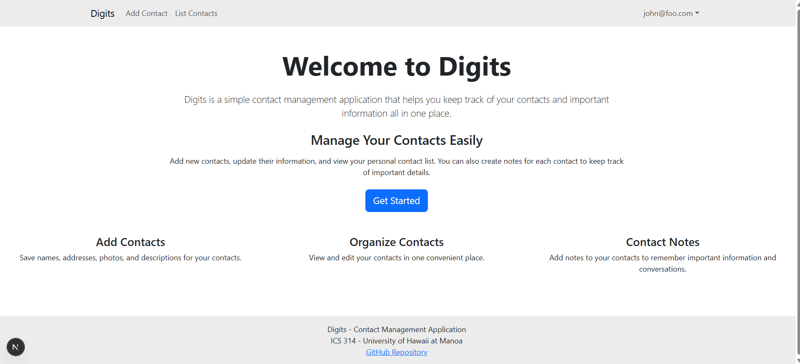
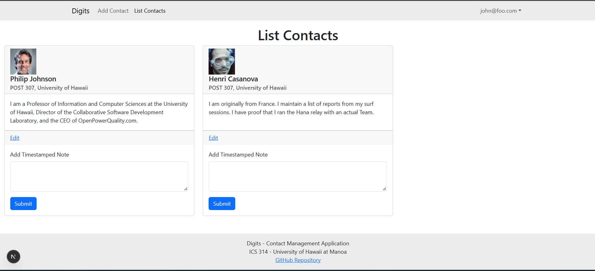
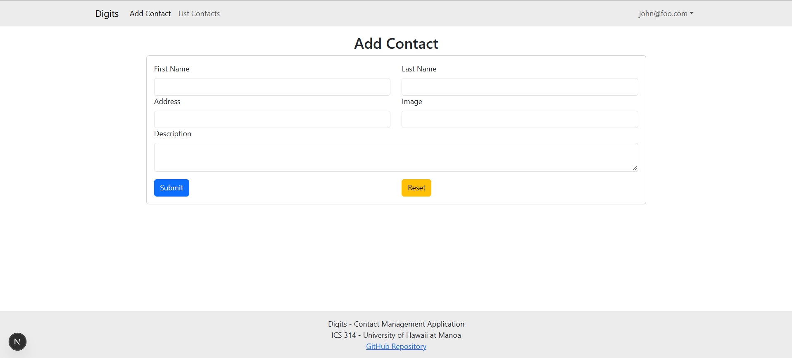
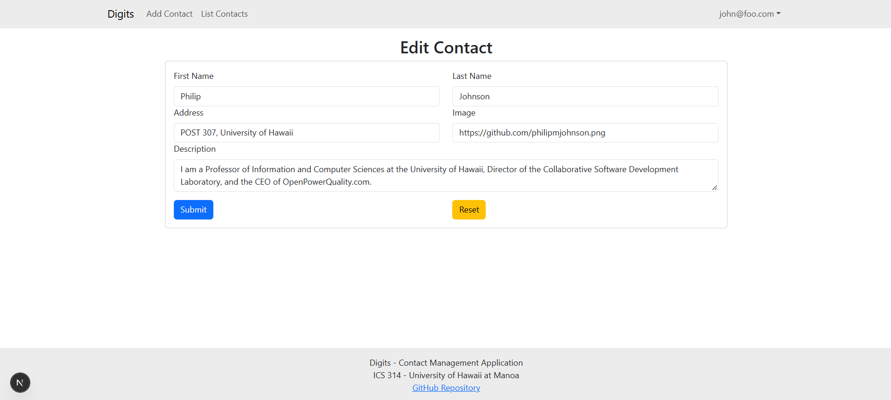
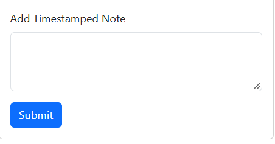
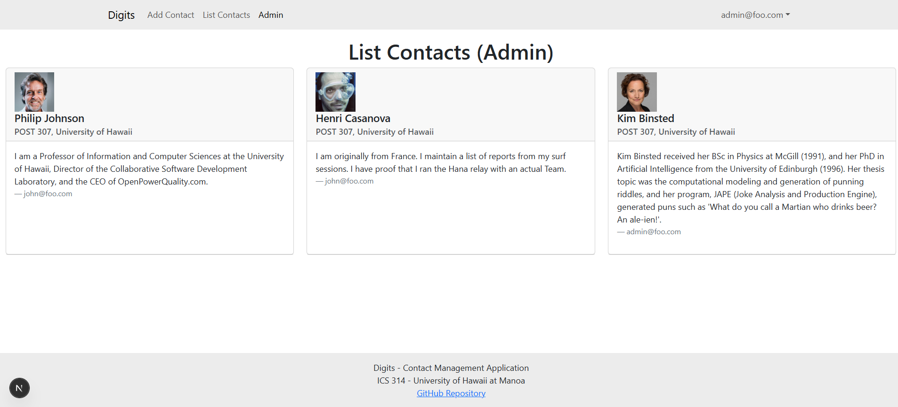

# Digits - Contact Management Application

Digits is a contact management web application built for ICS 314 at the University of Hawaii at Manoa. It allows users to create and manage their own contacts, update contact information, and add notes to keep track of important details.

The application is built using Next.js, React, Bootstrap 5, Prisma, and PostgreSQL. It also includes user authentication and admin functionality.

## Installation

### Requirements

Before running the application, install:

- Node.js and npm
- PostgreSQL
- Git

### Setup

1. Clone the repository:

   ```bash
   git clone https://github.com/rikisane/digits.git
   cd digits
   ```

2. Install the dependencies:

   ```bash
   npm install
   ```

3. Create a PostgreSQL database called `digits`.

   ```bash
   createdb digits
   ```

4. Create a `.env` file using `sample.env` as a reference. Set `DATABASE_URL` to your PostgreSQL connection string and configure the authentication secret required by NextAuth.

5. Apply the database migrations:

   ```bash
   npx prisma migrate deploy
   ```

6. Generate the Prisma Client:

   ```bash
   npx prisma generate
   ```

7. Seed the database:

   ```bash
   npx prisma db seed
   ```

8. Start the application:

   ```bash
   npm run dev
   ```

9. Open http://localhost:3000 in your browser.

### Default Accounts

The database includes two default accounts for testing.

| Account | Email | Password |
| --- | --- | --- |
| Regular User | john@foo.com | changeme |
| Administrator | admin@foo.com | changeme |

These credentials are intended for local development only.

## Application Walkthrough

### Landing Page


The landing page introduces Digits and explains its main features. Users can learn about managing contacts and click Get Started to sign in.

### User Authentication

Users can sign in with an existing account or register a new account. The application also includes sign-out and change-password functionality.

Once signed in, users can access their personal contacts.

### List Contacts



The List Contacts page displays the contacts belonging to the currently signed-in user.

Each contact includes a name, address, image, and description. Users can also access the editing and notes features.

### Add Contact



The Add Contact page allows users to create contacts by entering a first name, last name, address, image URL, and description.

After submitting the form, the new contact is saved to the database.

### Edit Contact



Users can edit the information for contacts they own. They can update the contact's name, address, image, and description.

Users cannot edit contacts belonging to another account.

### Contact Notes



The Notes feature lets users add notes to individual contacts.

Each note is connected to a specific contact and includes a timestamp. This helps users keep track of important information and conversations.

### Admin Page



Administrators have access to a separate Admin page that displays contacts from all users.

Regular users can only view their own contacts and cannot access the admin page.

## Database

Digits uses PostgreSQL with Prisma ORM.

The application includes three main models:

- **User:** Stores account information, hashed passwords, and user roles.
- **Contact:** Stores contact names, addresses, images, descriptions, and owners.
- **Note:** Stores notes associated with contacts, including timestamps and ownership information.

Database migrations are stored in `prisma/migrations`, and initial account and contact information is provided in `config/settings.development.json`.

## Technologies Used

- Next.js 16
- React
- TypeScript
- Bootstrap 5 and React Bootstrap
- PostgreSQL
- Prisma ORM
- NextAuth
- React Hook Form
- Yup validation

## Quality Assurance

The application uses ESLint to check code quality:

```bash
npm run lint
```

To verify that the application builds successfully:

```bash
npm run build
```

Playwright is available for end-to-end testing:

```bash
npx playwright test
```

## Repository

GitHub Repository: https://github.com/rikisane/digits

This project was developed as part of ICS 314: Software Engineering at the University of Hawaii at Manoa.
